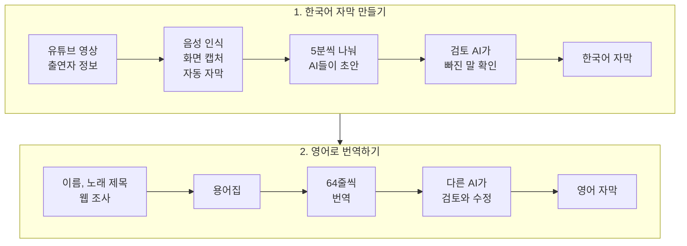

# 한국어 영상 전사 번역 모듈

누구나 프로덕션 수준의 번역 자막을 만들 수 있게 하는 AI 에이전트 워크플로우입니다. 한국어 영상을 한국어 자막으로 전사하고 영어 자막으로 번역합니다.

## 무엇이 다른가

자막은 한 줄만 봐서는 알 수 없는 것이 많습니다. 누가 누구에게 하는 말인지, 그때 화면에 무엇이 보이는지, 어떤 단어가 노래 제목인지는 그 줄에 적혀 있지 않습니다. 아래는 음악 토크쇼의 한 장면입니다. 게스트가 얼마 전 낸 노래 "밤새" 이야기를 하고 있고, 화면에는 게스트의 데뷔 때 사진이 떠 있습니다. 이 노래의 작곡가는 여성입니다.

| | 원문 | 한 줄씩 번역하면 | 이 워크플로우 |
|---|---|---|---|
| 1 | 호스트: 저도 "밤새" 듣고 왔어요. | I listened to "All Night" too. | I've had "Bamsae" on repeat too. |
| 2 | 게스트: 진짜요? 저 사실 그 노래 | Really? Actually, that song | Really? Honestly, at first |
| 3 | 게스트: 처음엔 되게 싫어했거든요. | I really hated it at first. | I couldn't stand that song. |
| 4 | 게스트: 근데 작곡가님은 처음 듣고 울었대요. | But the composer cried when they first heard it. | But the composer cried the first time she heard it. |
| 5 | 호스트: 왜 울었대요? | Why did he cry? | Why did she cry? |
| 6 | 호스트: 근데 이때 진짜 말랐다. | But I was so skinny back then. | But look how skinny you were here. |
| 7 | (예능 자막) 급 화제 전환 | Sudden change of topic | [자막] Sudden change of topic |

줄마다 무엇을 보고 고쳤는지는 이렇습니다.

1. 번역 전에 만든 용어집에 이 노래의 공식 영어 제목이 "Bamsae"로 정해져 있습니다. 그래서 제목을 뜻대로 풀어 옮기지 않습니다.
2, 3. 두 줄을 한 문장으로 읽고 영어 어순에 맞게 다시 나눕니다. 한 줄씩 옮기면 2번 줄은 영어 문장이 되지 않습니다.
4, 5. 한국어는 he와 she를 구분하지 않습니다. 한 줄씩 옮기면 번역기가 성별을 짐작해서 5번 줄처럼 "he"가 나오기도 합니다. 이 워크플로우는 회차 맥락에 적힌 작곡가 정보를 보고 두 줄 모두 "she"로 맞춥니다.
6. 한국어 원문에는 주어가 없습니다. 말하는 사람이 호스트이고 화면에 게스트 사진이 떠 있다는 것을 알아야 "you"로 옮길 수 있습니다.
7. 전사 단계에서 화면 글자와 실제 대사를 따로 표시합니다. 그래서 예능 자막이 누군가의 대사로 번역되지 않습니다.

번역이 끝나면 다른 AI가 처음부터 다시 읽습니다. 5번이나 6번처럼 성별이나 화자가 틀린 곳, 뜻이 빠지거나 바뀐 곳을 찾아서 그 부분만 다시 번역하게 합니다.

## 어떻게 돌아가나



## 폴더 구조

```text
├── .agents/skills/
│   ├── video-transcription/   # 전사 에이전트가 따르는 지침
│   └── video-translation/     # 번역 에이전트가 따르는 지침
├── src/
│   ├── transcription_module/  # 음성 인식, 화면 확인, 한국어 자막 확정
│   └── translation_module/    # 용어집, 묶음 번역, 검토, 결과 파일
├── docs/
│   ├── prd/                   # 기능별 설계 문서
│   └── contracts/             # 파일 형식(JSON 스키마)과 예시
├── scripts/                   # 보조 스크립트
└── tests/                     # 테스트 1,300여 개
```

## 사용법

### 준비물

- macOS Apple Silicon
- Python 3.13
- `uv`
- FFmpeg와 ffprobe
- Claude Code나 Codex 같은 코딩 에이전트

### 설치

```bash
brew install uv ffmpeg
uv python install 3.13
git clone https://github.com/iamwoosunglee-boop/korean-english-subtitle-ai.git
cd korean-english-subtitle-ai
uv sync --frozen
```

음성 인식 모델(mlx-whisper)은 처음 전사할 때 내려받습니다. 그래서 첫 실행은 시간이 더 걸립니다.

### 1. 한국어 자막 만들기

에이전트에서 이 저장소를 열고 이렇게 요청합니다.

```text
https://www.youtube.com/watch?v=jNQXAC9IVRw 영상을 한국어 원어 자막으로 전사해 주세요.
```

에이전트가 먼저 출연자 정보를 묻습니다. 출연자 이름과 옷차림, 생김새를 적어 주면 이름을 더 정확하게 전사합니다. 알려 줄 정보가 없으면 `없음`이라고 답하면 됩니다.

작업 중에 AI가 판단하지 못한 부분은 하나씩 물어봅니다. 끝나면 `runs/<실행 ID>/source.json`에 한국어 자막이 저장됩니다.

### 2. 영어로 번역하기

1단계에서 만든 파일을 넘기며 요청합니다.

```text
runs/<실행 ID>/source.json 을 영어 자막으로 번역해 주세요.
```

에이전트가 용어집을 만들고 번역과 검토를 마친 뒤 영어 자막 파일을 만듭니다.

### 명령어로 직접 실행하기

단계별 명령은 아래에서 확인할 수 있습니다.

```bash
uv run transcription-cli --help
uv run translation-cli --help
```

## 문제 해결

- FFmpeg를 찾지 못하면 `brew install ffmpeg`로 설치한 뒤 `ffmpeg -version`이 나오는지 확인합니다.
- 삭제됐거나 지역 제한이 걸린 영상은 받을 수 없습니다. 브라우저에서 재생되는 영상인지 확인합니다.
- 작업이 `needs_confirmation`에서 멈춰 있으면 오류가 아닙니다. AI가 확인받을 항목이 남아 있으니 질문에 답하면 이어서 진행합니다.
