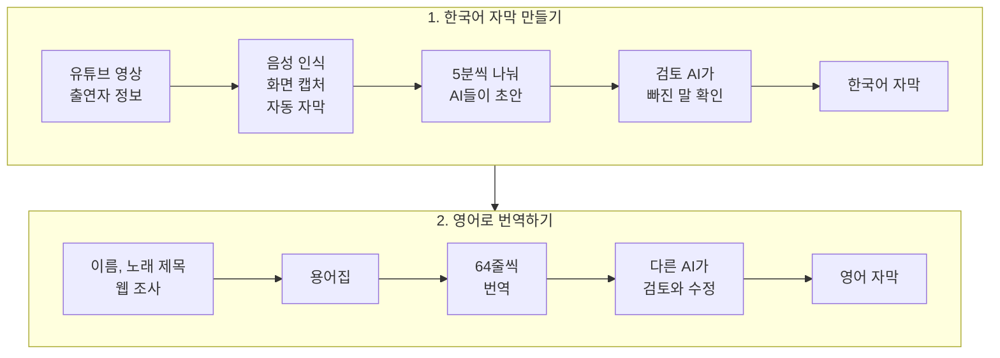

# 한국어 영상 전사 번역 모듈

누구나 프로덕션 수준의 번역 자막을 만들 수 있게 하는 AI 에이전트 작업 흐름입니다. 한국어 영상에서 한국어 자막을 받아 적고 영어 자막으로 번역합니다.

## 어떻게 돌아가나



## 사용법

### 준비물

- macOS Apple Silicon
- Python 3.13
- `uv`
- FFmpeg와 ffprobe
- Claude Code나 Codex 같은 코딩 에이전트

### 설치

```bash
brew install uv ffmpeg
uv python install 3.13
git clone https://github.com/iamwoosunglee-boop/korean-english-subtitle-ai.git
cd korean-english-subtitle-ai
uv sync --frozen
```

음성 인식 모델(mlx-whisper)은 처음 전사할 때 내려받습니다. 그래서 첫 실행은 시간이 더 걸립니다.

### 1. 한국어 자막 만들기

에이전트에서 이 저장소를 열고 이렇게 요청합니다.

```text
https://www.youtube.com/watch?v=jNQXAC9IVRw 영상을 한국어 원어 자막으로 전사해 주세요.
```

에이전트가 먼저 출연자 정보를 묻습니다. 출연자 이름과 옷차림, 생김새를 적어 주면 이름을 더 정확하게 받아 적습니다. 알려 줄 정보가 없으면 `없음`이라고 답하면 됩니다.

작업 중에 AI가 판단하지 못한 부분은 하나씩 물어봅니다. 끝나면 `runs/<실행 ID>/source.json`에 한국어 자막이 저장됩니다.

### 2. 영어로 번역하기

1단계에서 만든 파일을 넘기며 요청합니다.

```text
runs/<실행 ID>/source.json 을 영어 자막으로 번역해 주세요.
```

에이전트가 용어집을 만들고 번역과 검토를 마친 뒤 영어 자막 파일을 만듭니다.

### 명령어로 직접 실행하기

단계별 명령은 아래에서 확인할 수 있습니다.

```bash
uv run transcription-cli --help
uv run translation-cli --help
```

## 문제 해결

- FFmpeg를 찾지 못하면 `brew install ffmpeg`로 설치한 뒤 `ffmpeg -version`이 나오는지 확인합니다.
- 삭제됐거나 지역 제한이 걸린 영상은 받을 수 없습니다. 브라우저에서 재생되는 영상인지 확인합니다.
- 작업이 `needs_confirmation`에서 멈춰 있으면 오류가 아닙니다. AI가 확인받을 항목이 남아 있으니 질문에 답하면 이어서 진행합니다.
