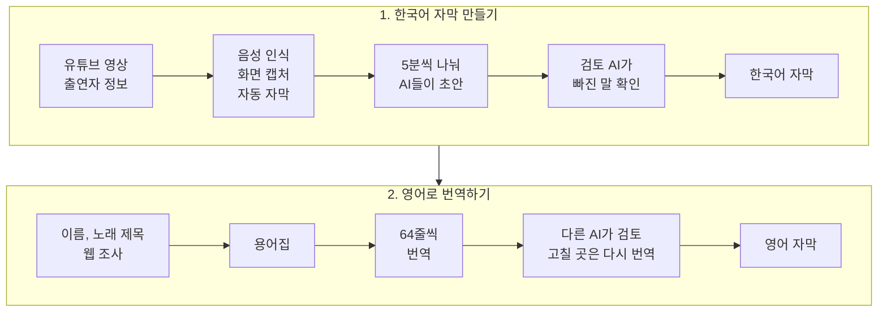

# 한국어 영상 전사 번역 모듈

한국어 예능 영상을 넣으면 한국어 자막을 만들고 영어 자막으로 번역하는 AI 에이전트 작업 흐름입니다.

## 왜 만들었나

저는 영어 번역을 못합니다. 그래서 번역을 AI에게 맡기기로 했습니다.

하지만 영상 자막을 AI에게 그냥 번역시키면 결과가 좋지 않았습니다. AI는 화면을 보지 못해서 누가 한 말인지 모르고 출연자 이름도 자주 틀립니다. 앞뒤 대화를 모른 채 한 줄씩 옮기다 보니 뜻이 어긋나는 문장도 많았습니다. 이대로는 실제로 쓸 수 있는 수준이 아니어서 아래처럼 작업 흐름을 직접 설계했습니다. 코드는 Codex와 Claude Code에게 지시해서 만들었습니다.

## 어떻게 돌아가나



## 설계에서 신경 쓴 점

| AI에게 그냥 맡기면 생기는 문제 | 이렇게 해결했습니다 |
|---|---|
| 출연자 이름을 틀리고 누가 말했는지 모름 | 작업 전에 출연자 이름과 옷차림을 먼저 받습니다. 이 정보가 들어와야 다음 단계가 시작됩니다 |
| 음성 인식이 웃음소리나 겹친 말을 빠뜨림 | 음성 인식, 화면, 자동 자막을 나란히 비교합니다. 목소리는 있는데 자막이 없는 곳은 따로 찾아서 채웁니다 |
| 긴 영상을 한 번에 맡기면 뒤쪽 품질이 떨어짐 | 5분씩 나눠 여러 AI가 동시에 씁니다. 구간 앞뒤 15초를 함께 보여 줘서 문장이 중간에 끊기지 않습니다 |
| 화면에 뜬 예능 자막을 대사로 착각함 | 화면 글자를 실제 대사와 꾸밈 자막으로 나눠서 기록합니다 |
| 이름과 노래 제목을 제멋대로 영어로 옮김 | 번역 전에 웹에서 공식 영어 표기를 찾아 용어집에 정해 둡니다 |
| 자기가 쓴 번역의 실수는 잘 못 봄 | 번역하는 AI와 검토하는 AI를 나눴습니다. 정해진 횟수 안에 해결되지 않으면 사람이 확인합니다 |

## 지원 환경

- macOS Apple Silicon
- Python 3.13
- `uv`
- FFmpeg와 ffprobe
- 모델과 영상을 받을 네트워크 및 충분한 로컬 디스크

Intel Mac, Linux와 Windows는 현재 지원 범위가 아닙니다.

## 설치

```bash
brew install uv ffmpeg
uv python install 3.13
git clone https://github.com/iamwoosunglee-boop/korean-english-subtitle-ai.git
cd korean-english-subtitle-ai
uv sync --frozen
uv run transcription-cli --help
```

`mlx-whisper` 모델은 첫 전사 때 내려받으므로 처음 한 번은 시간이 더 걸립니다.

## 에이전트로 빠르게 시작

이 저장소를 에이전트 환경에서 연 뒤 다음처럼 요청합니다.

```text
https://www.youtube.com/watch?v=jNQXAC9IVRw 영상을 한국어 원어 자막으로 전사해 주세요.
```

에이전트는 먼저 실행 ID를 만들고 `waiting_context`에서 멈춥니다. 등장인물의
이름, 의상, 외형과 화면 자막 신뢰도를 자유롭게 설명하거나 `없음`이라고
답해야 ASR과 비전 처리를 시작합니다.

## Canonical JSON 처리 흐름

아래 URL은 형식 예시입니다. 실제 작업에서는 전사할 공개 YouTube URL로
바꾸십시오.

```bash
export URL='https://www.youtube.com/watch?v=jNQXAC9IVRw'
export RUNS_DIR="$PWD/runs"
export START_OUTPUT="$(
  uv run transcription-cli start "$URL" --runs-dir "$RUNS_DIR"
)"
export RUN_ID="$(
  printf '%s\n' "$START_OUTPUT" |
    uv run python -c 'import json, sys; print(json.load(sys.stdin)["run_id"])'
)"

uv run transcription-cli protected-run "$RUN_ID" \
  --context '없음' \
  --youtube-browser chrome \
  --runs-dir "$RUNS_DIR"
uv run transcription-cli evidence-status "$RUN_ID" --runs-dir "$RUNS_DIR"
```

보호 실행은 자동 생성된 정확한 `ko-orig`만 요청합니다. `ko`, `ko-en`, 수동,
번역, 중복, 알 수 없는 track은 발화 근거가 아니며, `ko-orig`가 없으면
`optional_unavailable`로 기록하고 자막 없이 계속합니다. 같은 실행에서 canonical
policy와 정확한 subtitle inventory, audio/policy-bound VAD를 만들고 VAD는 단어와
화자를 주장하지 않습니다.

그 다음 에이전트는 같은 `RunStore`와 run ID로 typed Python interface
`create_window_drafts`와 `assemble_whole_transcript`를 호출합니다. 각 window는
5분 본문과 15초 이웃 문맥, 최대 4개 worker를 유지하며 typed visual observation,
correction receipt와 cue별 evidence coverage를 반환합니다. Policy-bound whole
assembly는 모델 callback으로 문장을 다시 쓰지 않고 source identity와 receipt를
결정적으로 reconcile합니다. 이미 반환된 관찰을 sidecar로 저장하므로 sidecar를
만들기 위한 두 번째 visual model pass를 실행하지 않습니다.

미확정 항목은 동의 후 한 항목씩 처리합니다.

```bash
uv run transcription-cli start-confirmation "$RUN_ID" --runs-dir "$RUNS_DIR"
uv run transcription-cli confirmation-consent "$RUN_ID" --accept \
  --runs-dir "$RUNS_DIR"
uv run transcription-cli next-confirmation "$RUN_ID" --runs-dir "$RUNS_DIR"
uv run transcription-cli confirm "$RUN_ID" "$CONFIRMATION_ID" \
  --answer '사용자가 확정한 전체 값' \
  --runs-dir "$RUNS_DIR"
```

확인이 닫히면 stored-frame final review의 assignment, proposal, 실제 human approval을
완료하고 `validate`를 실행합니다. 검증 성공은 `context.input.json`과 canonical
`source-transcript.v2` 초본인 `source.json`을 원자적으로 만듭니다. 제품 JSON
workflow는 `transcript.json`에서 `source.json`으로 이어지며 ASS를 이 권위 경로에
넣지 않습니다.

```bash
uv run transcription-cli validate "$RUN_ID" --runs-dir "$RUNS_DIR"
uv run transcription-cli evidence-status "$RUN_ID" --runs-dir "$RUNS_DIR"
```

## 명령

| 명령 | 역할 |
| --- | --- |
| `transcription-cli start` | 실행을 만들고 회차 맥락을 기다립니다. |
| `transcription-cli context` | 회차 맥락을 저장합니다. |
| `transcription-cli prepare` | 영상, exact `ko-orig`, 오디오, PTS frame과 policy inventory를 준비합니다. |
| `transcription-cli transcribe` | 재사용 가능한 VAD를 만들고 mlx-whisper ASR 근거를 저장합니다. |
| `transcription-cli protected-run` | source fingerprint를 고정한 채 준비, ASR, 선택 diarization을 실행합니다. |
| `transcription-cli resume-evidence` | source 변경으로 실패한 기존 evidence의 재사용 가능성을 검증합니다. |
| `transcription-cli evidence-status` | authority hash, exact `ko-orig` 유무, 재사용과 무효화, lifecycle artifact를 읽기 전용으로 보고합니다. |
| `transcription-cli apply-vision` | 기존 legacy manifest 기반 비전 결정을 적용합니다. |
| `transcription-cli recover` | 저장된 VAD로 누락 후보를 확인 queue에 보냅니다. |
| `transcription-cli start-confirmation` / `confirmation-consent` | 사용자 동의가 필요한 확인 session을 시작합니다. |
| `transcription-cli next-confirmation` / `suggest` / `confirm` | 항목 하나를 조회하고 제안 또는 실제 답변을 append-only로 처리합니다. |
| `transcription-cli prepare-final-review` / `propose-final-review` | 현재 authority에 묶인 final review를 준비하고 제안합니다. |
| `transcription-cli approve-final-review` / `reject-final-review` | 실제 actor 결정을 digest-bound receipt로 기록합니다. |
| `transcription-cli apply-final-review` | 호환 입력을 typed final-review 적용 경계로 전달합니다. |
| `transcription-cli validate` | confirmation anchor와 모든 policy sidecar를 검증하고 canonical JSON을 게시합니다. |

## Authority 파일

결과는 `runs/<run_id>/`에 저장되고 Git에 포함되지 않습니다. 단계에 도달하지 않은
파일은 정상적으로 `absent`일 수 있지만, policy-bound 후속 단계가 요구하는 파일이
누락되거나 불일치하거나 오염되면 fail-closed입니다.

| 파일 | 내용 |
| --- | --- |
| `state.json`, `protected-run.json` | workflow/validation 상태와 source fingerprint 영수증 |
| `media.json`, `asr.json`, optional `diarization.json` | source, frame/PTS, stable ASR ordinal과 선택 voice cluster 근거 |
| `visual-evidence-policy.json`, `subtitle-inventory.json`, `vad.json` | canonical policy, exact `ko-orig` identity/absence, 1회 VAD |
| optional speaker-turn authority/decision/derived 파일 | 독립적으로 승인된 turn과 speaker 근거 |
| `window-drafts.json` | window 입력과 cue별 evidence coverage |
| `visual-observations.json`, `correction-receipts.json`, `cue-provenance.json` | typed observation, 결정적 correction/KEEP receipt, cue source trace |
| `whole-transcript.json`, `transcript.json`, `transcript.csv` | 결정적 assembly 영수증, 전사 authority와 파생 CSV |
| `confirmations.jsonl`, `confirmation-session.json` | append-only human confirmation lifecycle |
| `final-review-assignment.json`, `final-review-result.json`, `final-review.json` | policy binding, 결과, 승인과 nested confirmation anchor |
| proposal/decision/application receipt 파일 | final-review 제안, 실제 결정, 적용 authority |
| `validation.json`, `context.input.json`, `source.json` | 최종 gate와 canonical context/source JSON |

## 비전과 화면 자막

관찰은 화면 문구를 `speech_supporting | non_speech | unknown`, 근거를
`supported | conflicted | insufficient`로 분류합니다. 자동 결과는 `KEEP`, 후보
문자 범위만 쓰는 `REPLACE_SPAN`, 강한 조건의 `INSERT_CUE`, 변경 없는
`HOLD_FOR_CONFIRMATION`뿐입니다. 정적 예능 문구와 condensed/paraphrased 자막은
`speech`로 승격하지 않고 `screen_text`로 분리합니다.

기존 파생 결과나 혼합 결과는 `contaminated`로, 같은 영상의 새 policy-bound 비교는
`policy-clean paired diagnostic`으로만 표시합니다. 어느 쪽도 blind benchmark나
다른 영상에 일반화된 정확도 결과가 아닙니다.

## 로컬 대시보드

대시보드는 고객별 콘텐츠 등록, 진행 상태, 검수, 납품 영수증, 최신성과 오류를
현재 Mac에서 관리하는 로컬 운영 제품입니다. Senpi 입력창에서
`/dashboard`를 실행하면 정상 실행본을 시작하거나 재사용한 뒤 브라우저를
엽니다. 일반 운영에는 터미널 명령이 필요하지 않습니다.

비개발자용 시작, 온보딩, 콘텐츠 관리, 화면 해석, 백업, 복원, 오류 대응은
[로컬 운영 대시보드 안내](docs/dashboard-operator-guide.ko.md)를
따르십시오.

### 이전 기록과 데이터 권한

이전 실행은 명시적으로 콘텐츠에 연결하기 전까지 고객사, 납기, 납품 정보를
추측하지 않습니다. 이전 기록 색인은 제품에 내장된 고정 정책만 사용합니다.
정책은 확인된 coverage manifest의 SHA-256
`737662f8ab2ee6091822d471d5adff0d78e22bdd9d4879ead99cd82221670be3`
와 결합되어 있으며, 별도 manifest를 전달하면 byte digest와 파생 정책이
정확히 일치할 때만 허용됩니다. 불일치한 manifest는 데이터베이스를 만들거나
수정하기 전에 거부됩니다.

색인 보고서는 실행 ID, 원본 identity, 당시 workflow/validation 상태, 번역
revision/digest/lifecycle, 검수 chunk 식별자, 최종 감사 완료 여부만 기록합니다.
승인 원문이나 상태, 후보 digest, 파일 수정 시각, 프롬프트, 모델 원문,
터미널 출력은 backfill하지 않습니다. 동일 source는 재사용하고 변경된
source는 기존 보고서를 덮어쓰지 않은 채 충돌로 남깁니다.

### 백업과 복구

대시보드 운영 정본은 프로젝트의 `.dashboard` 폴더 전체입니다. 대시보드와
Senpi 세션을 종료한 뒤 이 폴더 전체를 복사해 백업하고, 복원할 때도 전체를
한 단위로 되돌립니다. 현재 폴더를 삭제하지 말고 별도 이름으로 보존한 뒤
복원본에서 콘텐츠 수, 마지막 정상 시각, 최근 납품 영수증을 확인하십시오.

시작 오류는 `PORT_IN_USE`, `DATA_MISSING`, `DATA_CORRUPT`,
`MIGRATION_FAILED`, `PERMISSION_DENIED`, `STARTUP_TIMEOUT`,
`OPEN_FAILED`로 구분되며 각각 한국어 복구 행동을 제공합니다. 기술 지원용
`dashboard-cli launch`, `dashboard-cli serve`, `dashboard-cli migrate
--dry-run` 경로는 유지되지만 일반 운영 흐름에는 필요하지 않습니다.

## 문제 해결

### FFmpeg를 찾지 못함

`brew install ffmpeg` 후 `ffmpeg -version`과 `ffprobe -version`을 확인하십시오.

### 영상을 사용할 수 없음

삭제, 비공개, 지역 제한 영상은 준비할 수 없습니다. 브라우저에서 공개 재생이
가능한지 확인하고 다른 URL로 새 실행을 만드십시오.

### 첫 전사가 오래 걸림

mlx-whisper 모델을 처음 내려받는 중일 수 있습니다. 네트워크와 디스크 여유를
확인하십시오.

### `needs_confirmation`에서 멈춤

오류가 아니라 사람이 판단해야 할 항목이 남은 상태입니다.
`next-confirmation`과 `confirm`을 차례로 실행하거나 현재 JSON, CSV 초본을
그대로 사용할 수 있습니다.

### 검증 실패

`validation.json`과 CLI의 구조화된 오류를 확인하십시오. 정본인
`transcript.json`을 기준으로 문제를 해결하고 다시 `validate`를 실행합니다.
